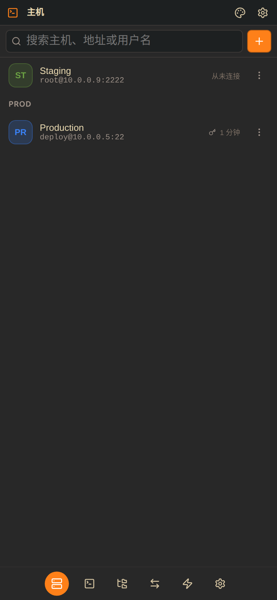

# ClawTerm

An SSH / SFTP terminal manager: multi-tab terminals, a remote file browser and
port forwarding, packaged as a web app **and** an Android app.

The Android build is a shell around the same Vue app the browser gets, and the
Go server that does the SSH work ships inside the APK — so the phone version and
the desktop version are the same code, not two implementations that drift.



## What it does

| | |
|---|---|
| **Multi-tab terminal** | One SSH shell per tab, kept alive across reconnects. Switch tabs without losing scrollback, the cursor position in a TUI, or the running process. |
| **Reconnect to the same shell** | A phone that sleeps, a Wi-Fi change, a server that hiccups — the client re-attaches to the same PTY and replays the scrollback. |
| **Key bar** | Esc / Tab / Ctrl / Alt / arrows / `\|` `-` `/` `~` above the keyboard. Tap a modifier for one keystroke, long-press to lock it. |
| **Three interaction modes** | Browse (drag scrolls), Gestures (swipe = arrows with hold-to-repeat, two-finger swipe = PgUp/PgDn, double-tap = Tab, pinch = font size), Select (drag paints a cell range with a copy/paste bar). |
| **In-terminal search** | Match count, next/previous, highlight colours derived from the active palette. |
| **157 terminal palettes** | Every scheme from `xterm-theme`, plus "follow the app theme". The picker previews each palette's own ANSI colours. |
| **SFTP file browser** | Browse, preview text, and download from the remote host. Directory navigation, breadcrumbs, "open a terminal here". |
| **Port forwarding** | `127.0.0.1:<local>` → `<remote>:<port>` over the SSH connection, with a one-tap "open in browser" for web UIs. |
| **Command snippets** | Saved commands, global or scoped to one host, sent with one tap. |
| **36 themes** | The same palette set as the rest of the family: VS Code-style named themes, light and dark, applied to the UI *and* the terminal. |
| **Host key verification** | Trust-on-first-use pinning with an explicit warning when a key changes. |

## Architecture

```
┌───────────────────────────────────────────┐
│ Vue 3 + TypeScript (web/)                 │
│   xterm.js  ·  fetch/WebSocket  ·  i18n   │
└───────────────┬───────────────────────────┘
                │ HTTP + WS on 127.0.0.1
┌───────────────▼───────────────────────────┐
│ Go server (cmd/termd)                     │
│   internal/handler   REST + WS            │
│   internal/terminal  PTY sessions, replay │
│   internal/sshx      ssh.Client, host keys│
│   internal/forward   local port forwards  │
│   internal/store     SQLite               │
│   internal/secret    AES-GCM credential   │
└───────────────────────────────────────────┘
```

The server binds **loopback only**. The UI is the only client, and a
LAN-reachable port would hand every stored SSH credential to anyone on the same
Wi-Fi.

On Android the Go binary is built as a PIE executable and shipped as
`lib/arm64-v8a/libtermd.so` — the app's native library directory is the only
place Android allows `exec` from, since the data directory is mounted `noexec`.

## Getting started

```bash
# Browser / desktop
./build.sh --restart          # build + run on http://127.0.0.1:20010

# Android
./build.sh --android          # debug APK at android/app/build/outputs/apk/debug/
./build.sh --android --release
```

On first launch you set an access password. It protects the stored host
credentials; every API route requires it.

### Development

```bash
npm run dev                   # Vite on :5173, proxying /api to :20010
go test ./...                 # backend
npx vitest run                # frontend
npx vue-tsc --noEmit -p web/tsconfig.json
```

`npm run dev` expects the server on port 20010 (see `vite.config.ts`); run
`./clawterm --port 20010` in another terminal.

## Data

Everything lives under one directory (`--data-dir`, default `~/.clawterm`):

```
clawterm.db          hosts, snippets, forwards, pinned host keys
secrets/master.key   AES-256 key (0600)
secrets/<id>.password
secrets/<id>.passphrase
```

The database and the secrets are deliberately separate files: a copied database
is not a copied credential store, and deleting a host removes its secret with a
single unlink.

Encryption here is **not** a defence against someone who can already read the
app's private data directory — on Android that boundary is the OS sandbox. It
raises the bar for the realistic accident (a backup or a directory shared
wholesale) and keeps the files non-greppable.

## Project layout

```
cmd/termd/              server entry point
internal/
  handler/              REST + WebSocket surface (routes_api.go is the list)
  terminal/             PTY session manager, scrollback ring buffer
  sshx/                 ssh client, host-key verification, SFTP
  forward/              local port forwards
  store/                SQLite (hosts, snippets, rules, known hosts, settings)
  secret/               encrypted credential files
  frontend/             static handler + //go:embed of the built UI
web/
  index.html            theme bootstrap runs before CSS loads
  css/                  variables.css holds all 36 themes
  src/components/       panels, sheets, shared primitives
  src/composables/      state (settings, hosts, terminal tabs, sessions, gestures)
android/                WebView shell + bundled server
docs/                   design notes
```

## Security notes

- The server binds `127.0.0.1`. There is no remote-access mode by design.
- The access password is stored as-is in the local DB and compared in constant
  time; it is a local gate, not an account system.
- Host keys are pinned on first connect. A changed key is reported with both
  fingerprints and requires an explicit "accept" action.
- Port forwards bind `127.0.0.1` only — never `0.0.0.0`.
- Cleartext HTTP is permitted for `127.0.0.1` only
  (`network_security_config.xml`); everything else is denied.

## Licence

MIT.
